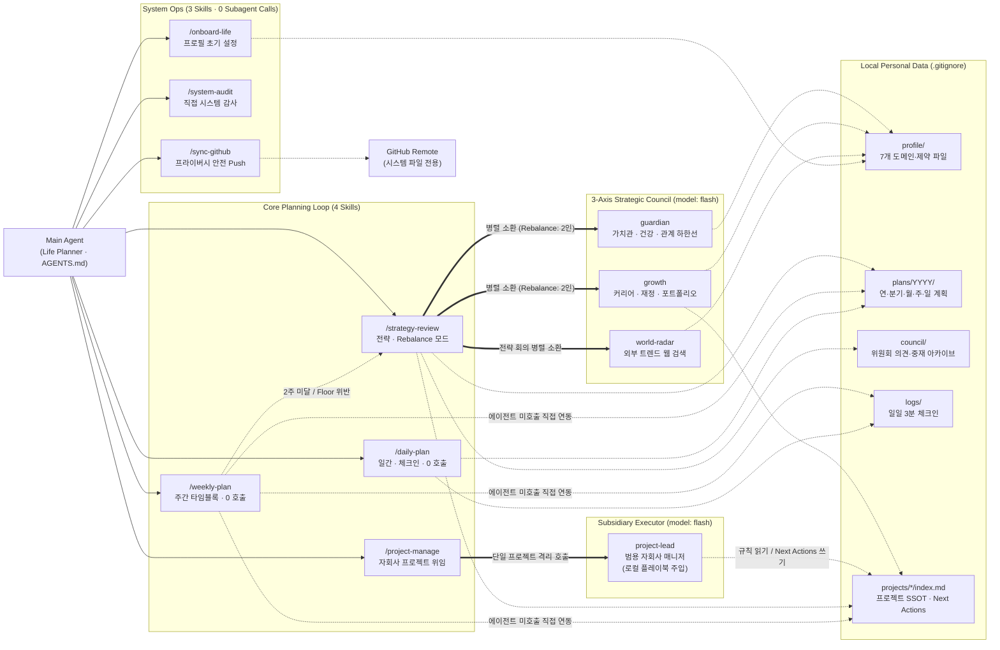

# Life Planner Architecture (4-Agent · 7-Skill)

> Visual references: this Mermaid map (GitHub / IDE / Obsidian) and [ARCHITECTURE.canvas](ARCHITECTURE.canvas) (interactive Obsidian Canvas).

## System Topology

## Design Contracts

### 1. Subagent Layer (4 Agents, All `model: flash`)
| Agent | File | Role | Read Boundary |
| :--- | :--- | :--- | :--- |
| `guardian` | `.agents/agents/guardian.md` | P0 floor defense & veto warnings | `profile/north-star.md`, `vitality.md`, `connection-joy.md` |
| `growth` | `.agents/agents/growth.md` | Mastery, wealth, and priority ranking | `profile/mastery.md`, `wealth.md`, `projects/*/index.md` summary |
| `world-radar` | `.agents/agents/world-radar.md` | Targeted external signal via web search | `profile/world-radar.md` + `search_web` |
| `project-lead` | `.agents/agents/project-lead.md` | Reusable playbook-driven project manager | Assigned `projects/<slug>/` folder only |

### 2. Mediation & Zero-Sum Rule
- **`guardian` vs. `growth` Mediation**: `guardian` protects floors and issues hard warnings; `growth` pushes high-leverage deliverables and ROI. The **Main Agent** mediates trade-offs impartially using `profile/north-star.md` and submits unresolved choices (2–3 scenarios) for user approval.
- **Hard 100% Cap**: P0 (fixed obligations + survival/dignity floors + ~20% buffer) locks first; `P1 → PN` fills strictly within `≤ 100%` of time and budget.

### 3. Single Source of Truth (SSOT) & Privacy
- **`projects/<slug>/index.md` (SSOT)**: Holds `status`, `weekly_quota_hours`, `## Operating Rules & Constraints` (playbook), `## Milestones`, and `## Next Actions`. Holding Company (`/strategy-review`) sets quota; `project-lead` writes Next Actions; `/weekly-plan` reads Next Actions directly with **0 subagent calls**.
- **Privacy Separation**: System files (`.agents/`, `AGENTS.md`, `ARCHITECTURE.*`, `templates/`, `README.md`) contain **zero** personal project names or private details and sync to GitHub. Personal folders (`profile/`, `plans/`, `logs/`, `council/`, `projects/`) stay strictly local via `.gitignore`.
